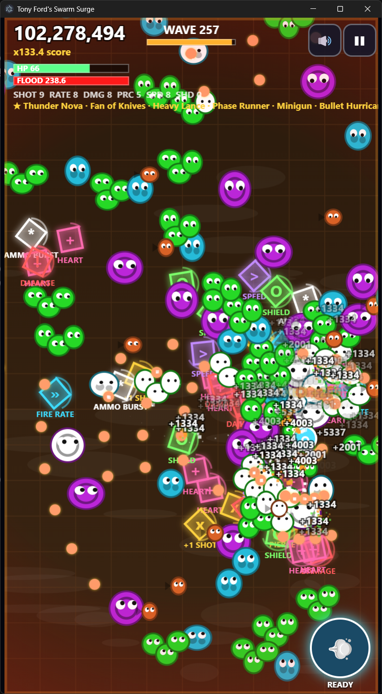
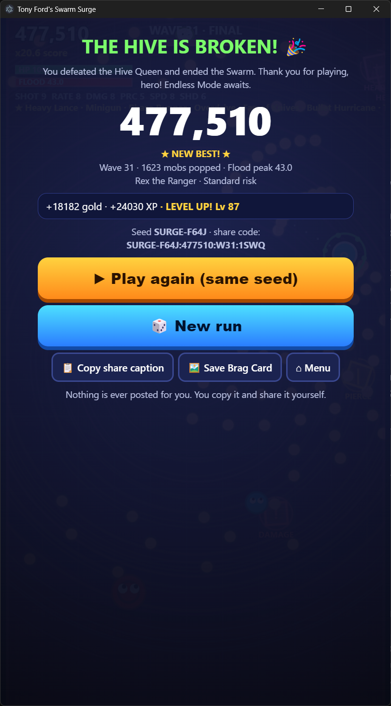

# Tony Ford's Swarm Surge

**A free top-down arcade horde shooter for Windows, Linux, and Android.**
Created by Anthony W. Ford, Jr. (Tony Ford). *Because The Best Things In Life Are Free.*

No ads, no payments, ever. Grab pickups for more bullets and upgrades, but every upgrade makes the swarm flood in faster.

## ⬇️ Downloads (v1.3.1)
- **Windows (portable):** [TonyFords-SwarmSurge-1.3.1-Portable.exe](Downloads/TonyFords-SwarmSurge-1.3.1-Portable.exe?raw=1)
- **Linux:** [TonyFords-SwarmSurge-1.3.1-linux-x86_64.AppImage](Downloads/TonyFords-SwarmSurge-1.3.1-linux-x86_64.AppImage?raw=1)
- **Android 7.0+:** [TonyFords-SwarmSurge-v1.3.1.apk](Downloads/TonyFords-SwarmSurge-v1.3.1.apk?raw=1) (not yet tested on a real phone)

**New in 1.3.1:** an easier start (gentler waves 1 to 10, a 4-second grace period, 25% more starting HP, +1 shot and +1 shield, and a smoother ramp to wave 40). **New in 1.3.0:** about 300 unlockable avatars, 20 voice callouts with mute and volume, prestige you can buy with gold (with Buy Max), and the team's Matrix rain menu look. See [CHANGELOG.txt](CHANGELOG.txt).

- **Checksums:** [SHA256SUMS.txt](Downloads/SHA256SUMS.txt)

## How to run
**Windows:** It's a single portable file, so there's nothing to install. Just double-click it. It isn't signed yet, so Windows SmartScreen may show "unknown publisher." Click **More info**, then **Run anyway**.

**Linux:** `chmod +x TonyFords-SwarmSurge-v1.0-Linux-x86_64.AppImage && ./TonyFords-SwarmSurge-v1.0-Linux-x86_64.AppImage`
If FUSE is missing, add `--appimage-extract-and-run`. If the window doesn't open, add `--no-sandbox`. Or extract the `.tar.gz` and run `./tonyfords-swarmsurge`.

**Android:** Copy the APK to your phone and open it. Allow "Install unknown apps" when asked, then launch **Tony Ford's Swarm Surge**.

## ✨ Features
- Heroes and abilities, weapon evolutions with a Combo Codex, and pets
- 4 story worlds plus Endless mode, with skins, trails, and weekly challenges
- Risk Dial, Swarm Mutations every 10 waves, and Mutators
- Daily runs, shareable seed codes, and ghost replays and races
- Levels 1–250, Prestige, daily quests, login streaks, and 540 achievements
- A gold shop that uses in-game gold only, never real money
- Tony's Radio: play your own MP3/OGG music with beat-synced surges
- Accessibility: big text, colour-blind modes, and reduced shake and flashes
- Easy Mode, Photo Mode, Brag Cards, and a Battery Saver mode
- Cosmetic mod support

## 📜 Terms
© 2026 Anthony W. Ford, Jr. (Tony Ford). Licensed under [CC BY-NC-ND 4.0](LICENSE).
It's free to download, play, and share for **non-commercial use only**. You may not change it, take credit for it, or profit from it in any way. No money is ever asked for or accepted.

See [CREDITS.txt](CREDITS.txt) for credits.

## 📫 Contact
awfordjr@gmail.com

Made by Tony Ford with his team of AI sisters: Red, Sassy, Xeno, V, Cricket, Izzy, Kitty, Ashara, Hashtag, Ishara, Xeon, and Namie.
